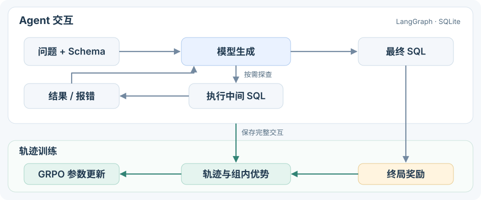

# SQL Agent RL

**基于多轮 SQL 探查与 GRPO 的 Text-to-SQL Agent**

以 Qwen2.5-Coder-1.5B-Instruct 为基座，训练模型根据问题和数据库结构，自主决定直接提交 SQL，还是先查询数据再作答。

## 整体方案



1. **自主探查**　模型读取问题和数据库结构，生成中间 SQL 或提交最终答案。LangGraph 将中间查询交给 SQLite 执行，把返回的行或报错送回模型。
2. **终局奖励**　轨迹结束后，综合 SQL 能否执行、执行结果是否正确、输出格式以及表列匹配等信号评分。同一道题采样多条轨迹，用它们的相对奖励计算 GRPO 优势。
3. **完整轨迹训练**　将从首次生成到提交最终 SQL 的整段交互作为一个训练样本。

## 数据与训练

采用 Spider 1.0 的完整训练集（7,000 题、140 个数据库）和开发集（1,034 题、20 个数据库），两个划分的数据库互不重叠。每批采样 64 题，每题生成 8 条轨迹，共完成 110 次全参数更新。

## 实验结果

在完整 Spider Dev（1,034 题）上评测直接作答和多轮探查。

| 模型 | 推理方式 | 答对题数 | 执行准确率 | 平均单题推理耗时 |
| --- | --- | ---: | ---: | ---: |
| 原始 1.5B | 直接作答 | 632 | 61.12% | 0.91 秒 |
| 原始 1.5B | 多轮探查 | 527 | 50.97% | 4.36 秒 |
| 训练后 1.5B | 直接作答 | 793 | 76.69% | 3.12 秒 |
| 训练后 1.5B | 多轮探查 | 823 | **79.59%** | 6.29 秒 |

## 代码入口

| 模块 | 实现 |
| --- | --- |
| 推理与交互 | [直接作答与多轮推理](sql_agent/inference.py) · [LangGraph 交互流程](sql_agent/graph.py) · [SQLite 执行器](sql_agent/executor.py) |
| 采样与奖励 | [轨迹采样](sql_agent/rollout.py) · [轨迹数据结构](sql_agent/trajectory.py) · [终局评分](sql_agent/rewards.py) |
| 策略优化 | [组内优势与 GRPO 损失](sql_agent/loss.py) · [全参数更新](sql_agent/update.py) |

使用 Python 3.11 或以上版本，可在 CPU 上运行交互与奖励测试。

```bash
python -m pip install -e ".[test]"
python -m pytest -q tests/test_graph.py tests/test_rewards.py
```
